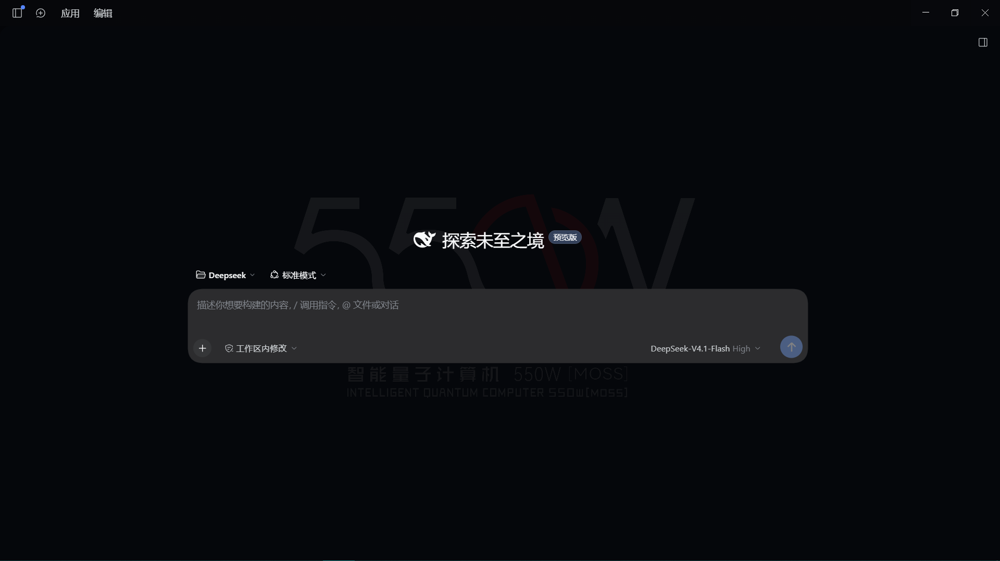
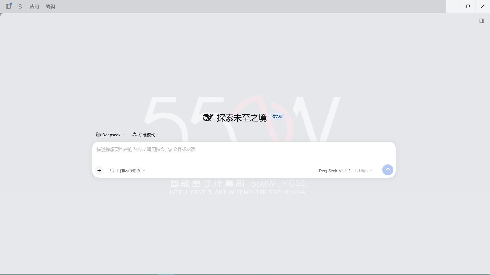

# DSH-550W-Theme (MOSS 550W 极简透明主题)

一个为 DSH 打造的自定义半透明毛玻璃主题。包含本地自定义 CSS 插件，彻底解决图片加载路径问题。

## 效果预览 (Preview)

###  深色模式 (Dark Mode)

###  浅色模式 (Light Mode)

##  特性 (Features)
- **底层变量覆盖**：不瞎猜 class，直接覆盖底层 CSS 变量，兼容性极佳。
- **半透明磨砂**：面板半透明 + backdrop-filter 磨砂效果。
- **双主题适配**：完美适配深色与浅色模式。
- **高可玩性**：只需修改 `assets` 目录下的图片，即可换成你自己的壁纸。

##  如何使用 (Installation)
1. 在右侧 **Releases** 下载最新的 `zip` 压缩包。
2. 解压后，运行 `install.ps1` 脚本（或手动将 `custom-css` 文件夹放入 DSH 插件目录）。
3. 重启 DSH，在设置中启用 `@local/custom-css` 插件即可生效。
##  如何更换壁纸？
将你喜欢的图片命名为 `550w.png`，替换掉 `custom-css/assets/` 目录下的原图，保存后 1 秒生效。
